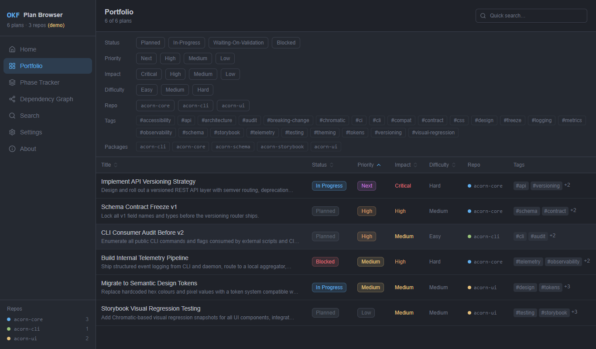
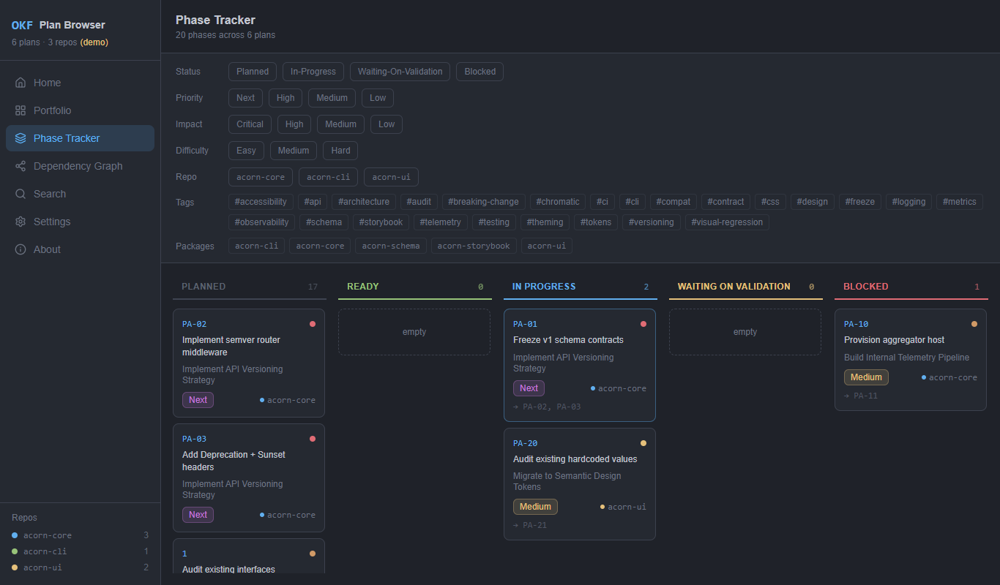
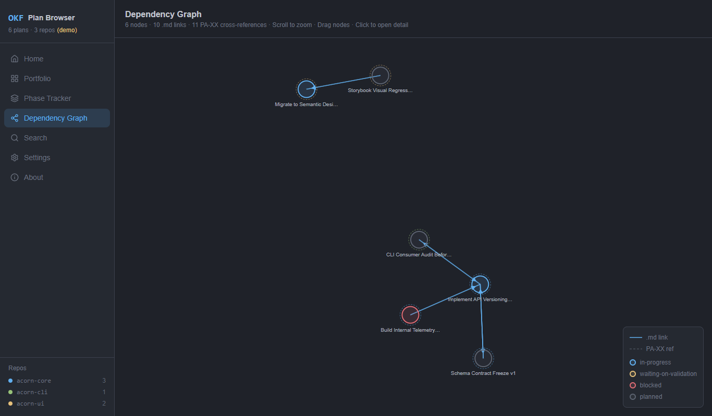
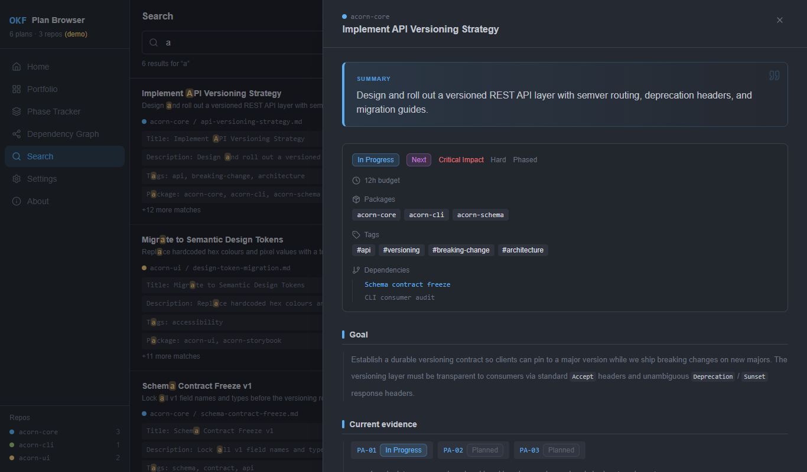
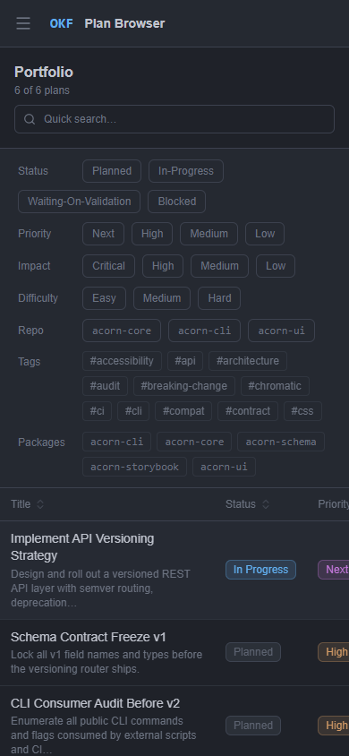

# OKF Plan Browser

> A web + desktop application for browsing, visualising, and searching `.wiki` markdown planning portfolios — built with React, Vite, shadcn/ui, and Tauri.


🌐 **Live demo:** `https://www.jasonwohlgemuth.com/okf-plan-browser/`



| Phase Tracker | Dependency Graph |
| --- | --- |
|  |  |

| Plan detail | Mobile |
| --- | --- |
|  |  |

*Screenshots are the visual regression baselines (demo data). Refresh with `npm run screenshots` after `npm run test:visual:update`.*

---

## Features

| View | What it does |
|---|---|
| **Portfolio** | Sortable, filterable table of all plans — by status, priority, impact, difficulty, tags, packages, repo |
| **Phase Tracker** | Kanban board across `planned → ready → blocked → in-progress` |
| **Dependency Graph** | D3 force-directed graph — nodes are plans, edges are `.md` links and `PA-XX` cross-references |
| **Search** | Full-text across titles, descriptions, section content, tags, packages, and phase titles |
| **Planning Skill** | Copy-ready `$planning` prompts plus the complete bundled skill, references, validator, tests, and agent metadata |

- 🌙 **One Dark theme** with Light / System toggle (persisted across sessions)
- 📂 **File System Access API** (`showDirectoryPicker`) + drag-and-drop fallback
- 🌐 **Remote repos** — paste a GitHub `owner/repo` (optional token in Settings for private repos) or a public GitLab project URL, including a custom host
- 🗂️ **Multiple repos** — "Add another .wiki" merges data with distinct repo colour labels
- 🔄 **One-click refresh** — re-read a single wiki or all wikis from the sidebar. Remote wikis re-fetch from the forge. Chromium browsers remember a local folder (and may ask to re-allow access after a restart); in Firefox/Safari a local wiki's refresh button re-opens the folder picker and re-uploads into the same project
- 🖱️ **Slide-in detail panel** — click any plan for full frontmatter, sections, phases, dependencies
- 🎭 **Embedded demo data** — 6 synthetic plans load instantly with no files required
- 🖥️ **Optional Tauri desktop app** — native window, no Electron overhead
- ⚙️ **GitHub Actions** — CI, GitHub Pages deploy, multi-platform Tauri release, automated versioning

---

## Your `.wiki` format

The app reads plain markdown files with YAML frontmatter:

```markdown
---
type: Plan
title: "My Plan Title"
description: "What this is about"
difficulty: medium          # easy | medium | hard
impact: critical            # low | medium | high | critical
package: [workspace, acorn-lib]
tags: [feature, automation]
status: planned             # planned | ready | in-progress | blocked | waiting-on-validation
priority: next              # next | high | medium | low
execution: phased           # phased | coordination
phase_budget_hours: 5
---

# Goal
Narrative context...

# Current evidence
- Bullet log

## PA-01 Phase title
**Status:** planned
Phase body with cross-references like PA-02, PA-03...

# Dependencies and stop gates
- [Other plan](../other-repo/.wiki/other-plan.md)
```

**Notes:**
- Status values are `planned | ready | in-progress | blocked | waiting-on-validation` — completed plans are **deleted** from `.wiki/`, not marked done.
- Phase IDs follow the pattern `PA-01`, `PA-02`, etc. (or `1.`, `2.` numbered variants).
- Dependency links use standard markdown: `[text](../relative/path.md)`.
- Each repo has one `.wiki/` root folder containing multiple `.md` plan files.

---

## Quick start

```bash
git clone https://github.com/jhwohlgemuth/okf-plan-browser.git
cd okf-plan-browser
npm install
npm run dev
```

Open `http://localhost:5173` in Chrome or Edge. Click **Open Folder** and pick any `.wiki/` directory, paste a GitHub `owner/repo` or GitLab URL, or click **Load Demo Data** to explore immediately.

Private GitHub repositories should use an expiring fine-grained token limited to the selected repositories with **Contents: read**, saved under **Settings → GitHub**. GitLab tokens are stored per exact host; prefer an expiring project token or a personal token with only `read_repository`. Web tokens are session-only and are disabled on insecure HTTP. The desktop app stores credentials in the operating system credential store and performs authenticated requests outside the webview.

GitLab development proxy hosts are allowlisted. `gitlab.com` and `code.ornl.gov` are always enabled; add any other custom hosts before starting Vite, for example:

```powershell
$env:OKF_GITLAB_HOSTS = 'gitlab.example.com'
npm run dev
```

Production web builds use the same variable to generate their CSP allowlist. Custom-host GitLab also requires that host to permit browser CORS. In supported browsers, the hosted app reads a GitLab `.wiki` archive in one request; if archives are unavailable, it falls back to the file API. A GitLab token does not bypass a host's CORS or gateway restrictions.

If `code.ornl.gov` reports that your IP address is restricted, ask your ORNL collaboration partner to request an exception for your network range. You can open an existing local checkout's `.wiki` folder in the meantime.

### Deployment security

The hosted web app must be served directly over HTTPS. Configure GitHub Pages and the custom-domain provider to redirect HTTP to HTTPS, then enable HSTS. The app attempts an HTTPS upgrade and refuses token storage in an insecure context, but client-side safeguards do not replace a server-side HTTPS redirect. Host the app on a dedicated origin so unrelated same-origin applications cannot access its browser storage.

---

## Contributing

Development tasks, tests, deploying to GitHub Pages, desktop builds, releases and the project layout are documented in [CONTRIBUTING.md](CONTRIBUTING.md).

---

## Tech stack

| Layer | Library |
|---|---|
| UI framework | React 18 |
| Build tool | Vite 6 |
| Language | TypeScript 5.9 |
| Routing | React Router 7 |
| Styling | Tailwind CSS 3 + One Dark palette |
| Components | shadcn/ui (Radix primitives + CVA) |
| State | Zustand 5 (with persist middleware) |
| Graph | D3 7 (force simulation) |
| YAML | js-yaml 4 |
| Icons | Lucide React |
| Animation | CSS keyframes |
| Desktop | Tauri 1.6 (optional) |

---

## Browser compatibility

Chromium uses the **File System Access API** (`showDirectoryPicker`) to load `.wiki` folders. Other browsers use a directory-upload input or drag-and-drop fallback. Remote GitHub/GitLab loads use `fetch` and work in any modern browser. Folder picking is supported in:

- ✅ Chrome 86+
- ✅ Edge 86+
- ❌ Firefox (drag-and-drop works via `getAsFileSystemHandle` where available)
- ✅ Safari 11.1+ on macOS; Safari 18.4+ on iOS/iPadOS

Older iOS/iPadOS Safari versions can use the picker to select multiple Markdown plan files instead of a folder.

The demo data and all other features work in all modern browsers.

---

## License

MIT
